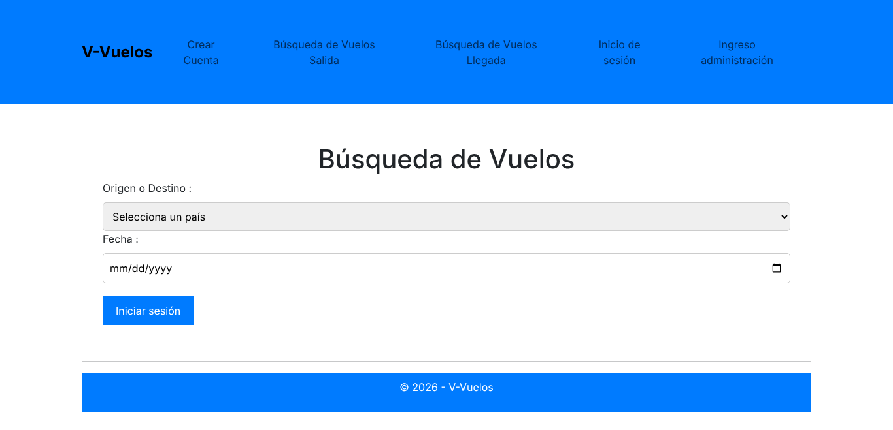
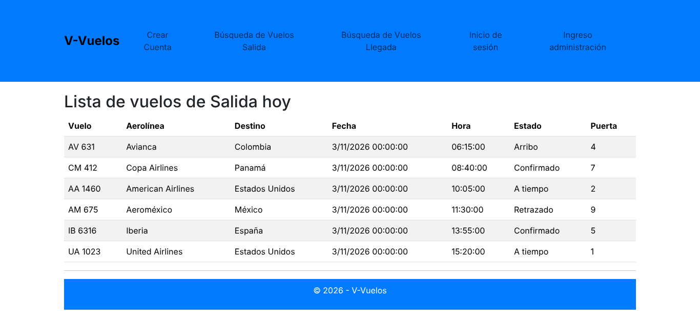
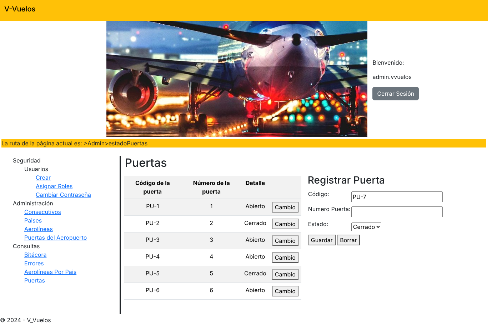
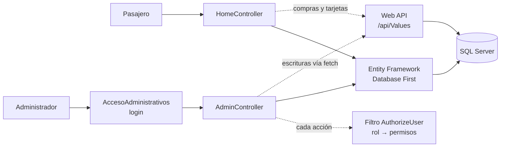

# V-Vuelos

Sistema web que simula la operación de un aeropuerto. Tiene dos caras: un portal donde los pasajeros consultan llegadas y salidas y compran vuelos, y un panel administrativo para gestionar aerolíneas, países, puertas de abordaje, usuarios y permisos.


---

## Capturas


*Portal de pasajeros: búsqueda de vuelos*

| Tablero de salidas del día | Panel administrativo: estado y registro de puertas |
|---|---|
|  |  |

> Capturas de las vistas reales del proyecto, generadas con datos de ejemplo.

## Funcionalidades

**Portal de pasajeros**
- Consulta de vuelos de llegada y de salida.
- Búsqueda y compra de vuelos por país de destino y fecha.
- Registro de cuenta e inicio de sesión, protegidos con Google reCAPTCHA, más inicio de sesión con Google.
- Gestión de tarjetas y métodos de pago, y seguimiento del estado de cada compra.

**Panel administrativo**
- Usuarios, roles y cambio de contraseña.
- Catálogos de aerolíneas, países y aerolíneas por país.
- Puertas de abordaje y su estado.
- Consecutivos configurables, con prefijo y rango, para numerar registros.
- Bitácora de acciones y registro de errores de la aplicación.

## Arquitectura



- **Patrón MVC** con ASP.NET MVC 5 y vistas Razor.
- **Control de acceso por permisos:** un filtro personalizado (`Filter/AuthorizeUser.cs`) revisa, antes de cada acción, si el rol del usuario en sesión tiene el permiso correspondiente a esa operación. Los permisos se configuran en la base de datos, sin tocar el código.
- **Acceso a datos con Entity Framework (Database First)**, a partir del modelo `Models/Model1.edmx`, para las consultas.
- **API REST separada para las operaciones de escritura:** registrar puertas y cambiar su estado, consecutivos, usuarios y roles, tarjetas y compras se envían con `fetch` a un servicio Web API (`/api/Values`) que corre aparte, en `http://localhost:5056`.
- **Trazabilidad:** las acciones administrativas quedan en una bitácora y los errores se guardan en la base de datos para su consulta desde el panel.

## Tecnologías

| Capa | Herramientas |
| --- | --- |
| Backend | C#, ASP.NET MVC 5 (.NET Framework) |
| Datos | SQL Server, Entity Framework 6 (Database First) |
| Frontend | Razor, Bootstrap, jQuery, jQuery Validation |
| Seguridad | Google reCAPTCHA, inicio de sesión con Google, autorización por roles y permisos |

## Estructura

```
V-Vuelos/
├── Controllers/   # Home (pasajeros), Admin y AccesoAdministrativos
├── Filter/        # AuthorizeUser: autorización por rol y operación
├── Models/        # Entidades generadas desde Model1.edmx
├── Views/         # Vistas Razor del portal y del panel
├── Content/       # Estilos
└── Scripts/       # jQuery, Bootstrap y validaciones
```

## Cómo correrlo

**Requisitos:** Windows, Visual Studio 2019 o superior con el componente de desarrollo web ASP.NET, y SQL Server (Express o LocalDB).

1. Clona el repositorio y abre `V-Vuelos.sln` en Visual Studio.
2. Restaura los paquetes NuGet (clic derecho en la solución → *Restaurar paquetes NuGet*).
3. Crea la base de datos `V_vuelos_Proyecto` en SQL Server y ajusta la cadena de conexión `V_vuelos_ProyectoEntities` en `Web.config`.
4. Configura tus propias claves en `Web.config`, sección `appSettings`:
   - `RecaptchaSiteKey` y `RecaptchaSecretKey`, desde [Google reCAPTCHA](https://www.google.com/recaptcha/admin).
   - Las credenciales de OAuth para el inicio de sesión con Google, desde [Google Cloud Console](https://console.cloud.google.com/apis/credentials).
5. Levanta la Web API que atiende `/api/Values` en el puerto 5056 (proyecto aparte).
6. Ejecuta con **F5**.

> Las claves de reCAPTCHA y Google que aparecen en el historial del repositorio fueron revocadas. Usa las tuyas.

## Equipo

Proyecto académico de Ingeniería Informática desarrollado en equipo (2024), con trabajo organizado en ramas y pull requests.

- **José Pablo Orozco Salas** · [LinkedIn](https://www.linkedin.com/in/jos%C3%A9-pablo-orozco-salas-8b766bb8/) · [GitHub](https://github.com/ozco26)
- [Agrega aquí a tus compañeros]
